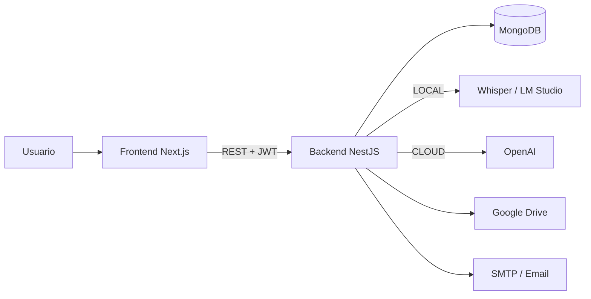

<div align="center">


# RootSearch

**Plataforma educativa con contenido adaptativo generado por inteligencia artificial.**

Monorepo con backend NestJS, frontend Next.js y procesamiento de audio/IA local o en la nube.

[](https://nodejs.org/)
[](https://nestjs.com/)
[](https://nextjs.org/)
[](https://react.dev/)
[](https://www.mongodb.com/)
[](https://www.docker.com/)
[](LICENSE)

[Descripción](#-descripción) ·
[Características](#-características) ·
[Stack](#-stack-tecnológico) ·
[Inicio rápido](#-inicio-rápido) ·
[Scripts](#-scripts) ·
[Arquitectura](#-arquitectura) ·
[Documentación](#-documentación)

</div>

---

## Descripción

RootSearch permite a **docentes** y **estudiantes** gestionar cursos, compartir
materiales de estudio y generar contenido de refuerzo con IA a partir de
transcripciones de clase.

El sistema transcribe audio de una clase y genera automáticamente:

- Resúmenes estructurados en Markdown.
- Quizzes de opción múltiple con justificación.
- Glosarios de términos y definiciones.
- Checklists de estudio.
- Análisis de alineación entre la clase y el plan de estudios (syllabus).

Todo el procesamiento de IA puede ejecutarse **localmente** (sin coste) o en la
**nube** con OpenAI, sin cambios en el código de negocio.

## Características

- **Autenticación segura:** JWT, verificación por código enviado al correo y recuperación de contraseña.
- **Roles y permisos:** administrador, docente y estudiante, con control por endpoint.
- **Gestión de cursos:** creación, edición, matrícula de estudiantes y materiales por curso.
- **Materiales de estudio:** carga de PDF/PPTX/video, publicación y exportación a PDF.
- **Transcripción de audio:** adaptador local (Whisper/Ollama/LM Studio) o OpenAI Whisper.
- **Generación de contenido con IA:** resumen, quiz, glosario, checklist y alineación con el syllabus.
- **Métricas:** usuarios, cursos, materiales y estadísticas por docente.
- **API documentada:** Swagger disponible en `/api`.
- **Monorepo:** scripts unificados, dependencias compartidas y CI con GitHub Actions.
- **Docker:** imágenes multi-stage y Compose con MongoDB para desarrollo.

## Stack tecnológico

| Capa | Tecnología |
| --- | --- |
| Backend | NestJS 11, TypeScript, Mongoose, Passport JWT |
| Base de datos | MongoDB |
| Frontend | Next.js 16 (App Router), React 19, Tailwind CSS 4 |
| Autenticación | JWT, bcrypt, códigos de verificación por email |
| IA | OpenAI, Whisper local, LM Studio / Ollama |
| Documentos | pdf-parse, Puppeteer, marked |
| Infraestructura | Docker, Docker Compose, GitHub Actions |
| Calidad | ESLint 9, Prettier, Jest, Supertest |

## Estructura del proyecto

```text
RootSearch/
├── backend/                  API REST (NestJS)
│   ├── src/
│   │   ├── auth/             Autenticación, roles y permisos
│   │   ├── users/            Gestión de usuarios
│   │   ├── courses/          Cursos y matrícula
│   │   ├── materials/        Materiales y exportación a PDF
│   │   ├── audio/            Carga y transcripción de audio
│   │   ├── transcription/    Adaptadores LOCAL / CLOUD
│   │   ├── content-generation/ Adaptadores de generación con IA
│   │   └── seeds/            Datos de ejemplo
│   └── test/                 Pruebas end-to-end
├── frontend/                 Interfaz web (Next.js)
│   ├── app/                  Rutas y páginas (App Router)
│   ├── components/           Componentes reutilizables
│   ├── services/             Clientes de la API
│   └── public/               Recursos estáticos
├── docs/                     Documentación técnica
├── infra/docker/             Dockerfiles y Docker Compose
├── .github/workflows/        CI: lint, test, build y Docker
├── .env.example              Variables compartidas / Docker
└── package.json              Workspaces y scripts raíz
```

## Inicio rápido

### Requisitos

- **Node.js 22.12+** y npm 10+
- **MongoDB** local, Atlas o Docker
- Opcional: servidor local de transcripción y/o LM Studio para IA local

### 1. Clonar e instalar

```bash
git clone https://github.com/Eduardo37830/RootSearch.git
cd RootSearch
npm install
```

### 2. Configurar variables de entorno

```bash
# Backend
cp backend/.env.example backend/.env

# Frontend
cp frontend/.env.example frontend/.env
```

Edita `backend/.env` con tu `MONGODB_URI` y `JWT_SECRET`. Para Docker, usa el
`.env.example` de la raíz.

### 3. Ejecutar en desarrollo

```bash
npm run dev
```

Esto inicia ambos servicios en paralelo:

| Servicio | URL |
| --- | --- |
| Frontend | http://localhost:3000 |
| Backend | http://localhost:3001 |
| Swagger | http://localhost:3001/api |

También puedes ejecutarlos por separado:

```bash
npm run dev:backend
npm run dev:frontend
```

### 4. Datos de ejemplo (opcional)

```bash
npm run seed
```

## Docker

Levanta MongoDB + backend + frontend con hot reload:

```bash
docker compose -f infra/docker/docker-compose.dev.yml up --build
```

Servicios:

| Servicio | Puerto |
| --- | --- |
| Frontend | `3000` |
| Backend | `3001` |
| MongoDB | `27017` |

Para construir las imágenes de producción:

```bash
docker build -f infra/docker/backend.Dockerfile -t rootsearch-backend .
docker build -f infra/docker/frontend.Dockerfile --build-arg NEXT_PUBLIC_API_URL=http://localhost:3001 -t rootsearch-frontend .
```

## Scripts

Ejecutados desde la raíz del monorepo:

| Script | Descripción |
| --- | --- |
| `npm run dev` | Backend y frontend en modo desarrollo |
| `npm run dev:backend` | Solo backend con hot reload |
| `npm run dev:frontend` | Solo frontend |
| `npm run build` | Build de todos los workspaces |
| `npm run start` | Servicios en modo producción |
| `npm run lint` | ESLint en todos los workspaces |
| `npm run lint:fix` | ESLint con autofix |
| `npm run typecheck` | Verificación de tipos TypeScript |
| `npm run test` | Tests unitarios |
| `npm run test:e2e` | Tests end-to-end del backend |
| `npm run format` | Prettier en todos los workspaces |
| `npm run seed` | Carga datos de ejemplo |

## Variables de entorno

### Backend (`backend/.env`)

| Variable | Obligatoria | Descripción |
| --- | --- | --- |
| `MONGODB_URI` | Sí | Cadena de conexión de MongoDB |
| `JWT_SECRET` | Sí | Secreto para firmar los JWT |
| `PORT` | No | Puerto del backend (por defecto `3001`) |
| `CORS_ORIGIN` | No | Orígenes permitidos, separados por comas |
| `FRONTEND_URL` | No | URL usada en los enlaces de los correos |
| `EMAIL_SERVICE` / `EMAIL_USER` / `EMAIL_PASS` | Sí* | Envío de códigos de verificación |
| `GOOGLE_CLIENT_ID` / `GOOGLE_CLIENT_SECRET` / `GOOGLE_REFRESH_TOKEN` | Sí* | Almacenamiento en Google Drive |
| `TRANSCRIPTION_MODE` | No | `LOCAL` (por defecto) o `CLOUD` |
| `LOCAL_TRANSCRIPTION_ENDPOINT` | No | Endpoint del servidor de transcripción local |
| `CONTENT_GENERATION_MODE` | No | `LOCAL` (por defecto) o `CLOUD` |
| `LM_STUDIO_URL` | No | URL de LM Studio (por defecto `http://localhost:1234`) |
| `OPENAI_API_KEY` | No | Requerida si algún modo es `CLOUD` |

\* Necesarias para las funcionalidades de email y materiales en Drive.

### Frontend (`frontend/.env`)

| Variable | Descripción |
| --- | --- |
| `NEXT_PUBLIC_API_URL` | URL pública del backend (por defecto `http://localhost:3001`) |

## Servicios de IA

### Transcripción local

El backend espera un servidor de transcripción compatible con Whisper:

- Repositorio: [Eduardo37830/whisperServer](https://github.com/Eduardo37830/whisperServer)
- Configura `TRANSCRIPTION_MODE=LOCAL` y `LOCAL_TRANSCRIPTION_ENDPOINT`.
- Guía detallada: [`docs/transcription-server-setup.md`](docs/transcription-server-setup.md).

### Transcripción en la nube

```env
TRANSCRIPTION_MODE=CLOUD
OPENAI_API_KEY=sk-...
```

### Generación de contenido

- **Local:** abre LM Studio con un modelo cargado y define `LM_STUDIO_URL`.
- **Nube:** define `CONTENT_GENERATION_MODE=CLOUD` y `OPENAI_API_KEY`.

## Arquitectura



El backend sigue una arquitectura modular de NestJS, con servicios de negocio y
adaptadores intercambiables para IA. Más detalles en
[`docs/arquitectura.md`](docs/arquitectura.md).

## Calidad y CI

Los workflows de GitHub Actions se ejecutan en cada push y pull request a `main`:

- **Lint, typecheck, test y build** del monorepo.
- **Build de las imágenes Docker** de backend y frontend.

```bash
npm run lint
npm run typecheck
npm run test
```

## Documentación

| Documento | Contenido |
| --- | --- |
| [`docs/arquitectura.md`](docs/arquitectura.md) | Arquitectura, módulos y flujo de datos |
| [`docs/vision.md`](docs/vision.md) | Propósito, objetivos y alcance |
| [`docs/transcription-server-setup.md`](docs/transcription-server-setup.md) | Configuración del servidor Whisper |
| [`docs/troubleshooting-503.md`](docs/troubleshooting-503.md) | Solución de errores 503 en transcripción |
| [`docs/api-requests.json`](docs/api-requests.json) | Ejemplos de peticiones a la API |

## Contribución

1. Crea una rama: `git checkout -b feature/nueva-funcionalidad`
2. Realiza tus cambios y verifica la calidad:
   ```bash
   npm run lint && npm run typecheck && npm run test
   ```
3. Haz commit: `git commit -m "feat: agrega nueva funcionalidad"`
4. Push y abre un Pull Request.

## Roadmap

- [ ] Migrar el JWT de `localStorage` a cookies `HttpOnly`.
- [ ] Añadir tests de componentes y E2E al frontend.
- [ ] Incorporar paginación y filtros en los endpoints de listados.
- [ ] Tipar los servicios del frontend con TypeScript.
- [ ] Añadir rate limiting y Helmet en el backend.
- [ ] Documentar los endpoints con ejemplos de request/response.

## Licencia

Distribuido bajo la licencia **MIT**. Consulta [`LICENSE`](LICENSE) para más
información.

---

<div align="center">
Desarrollado para la asignatura <strong>Ingeniería de Software III</strong>.
</div>
